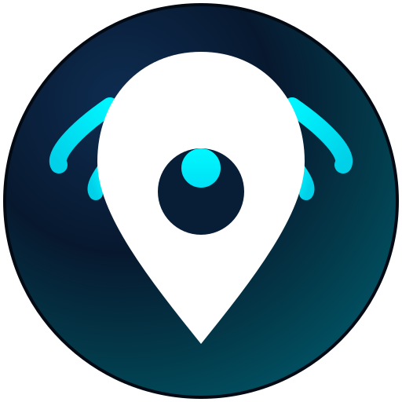

<div align="center">



# 🌍 Localiiiy (`v2.4.0`)
### Hyperlocal Social Radar, 4K Creator Studio & Safe-Haven Community Commerce

[](https://localiiiy.web.app)
[](https://play.google.com/store/apps/details?id=com.aistudio.localiiiy.live)
[](#📲-official-downloads--live-platform-links)
[](#🏗️-technical-architecture--tech-stack)

**Localiiiy** is a next-generation hyperlocal social discovery and peer-to-peer neighborhood commerce platform built with **Kotlin & Jetpack Compose** for Android and a **100% synchronized Progressive Web App (PWA)** at **[localiiiy.web.app](https://localiiiy.web.app)**.

It empowers verified neighbors to **Connect**, broadcast across a **Dual-Reach Lens (Neighbor • City • Earth)**, trade safely using **Police Precinct Safe-Haven Handshake OTP Escrow**, and browse privately with **Zero-GPS Ghost Mode** and **~110m Spatial Coordinate Fuzzing**.

</div>

---

## 📲 Official Downloads & Live Platform Links

| Platform | Status | Direct Link |
| :--- | :--- | :--- |
| 🤖 **Google Play Store (Android)** | **🟢 LIVE** | **[Download the app from Google Play Store](https://play.google.com/store/apps/details?id=com.aistudio.localiiiy.live)** |
| 🍎 **Apple App Store (iOS / iPadOS)** | **⏳ AVAILABLE SOON** | **Available Soon on the Apple App Store** *(Priority launch alerts available on web)* |
| 🌐 **Official Web Application (PWA)** | **🟢 LIVE (100% Android Synced)** | **[https://localiiiy.web.app](https://localiiiy.web.app)** |
| 📜 **Omnibus Terms of Service** | **🟢 LIVE (24-Article Charter)** | **[https://localiiiy.web.app/terms](https://localiiiy.web.app/terms)** |
| 🔒 **Global Privacy Policy** | **🟢 LIVE (GDPR / DPDP / CCPA)** | **[https://localiiiy.web.app/privacy](https://localiiiy.web.app/privacy)** |

> **📲 Download the app from Google Play Store:**  
> 👉 **[https://play.google.com/store/apps/details?id=com.aistudio.localiiiy.live](https://play.google.com/store/apps/details?id=com.aistudio.localiiiy.live)**  
> **🍎 Apple App Store:** **Available Soon**

---

## ✨ Core Platform Highlights

### 🧭 1. Six Synchronized Primary Decks (`Pulse` ➔ `Radar` ➔ `Market` ➔ `Clips` ➔ `Studio` ➔ `Space`)
Both the Android app and Web app share an identical 6-deck bottom navigation bar and real-time cloud schema:

1. **📡 Pulse (Live Hyperlocal Feed & Community Hub)**
   - **Tactile Tri-Dial Reach Lens:** Switch effortlessly between **🏘️ Neighbor (2 km)**, **🏙️ City (25 km)**, and **🌍 Earth (Global)** reach tiers.
   - **Discovery Filters:** Filter live broadcasts by `All`, `Nearby`, `Connected`, and `Verified`.
   - **24-Hour Proximity Stories & Polls:** Ephemeral neighborhood stories, civic polls, and local cooperative group updates.
2. **🧭 Radar (Tactical Proximity Sweep & Ghost Cloak)**
   - **Interactive Radar HUD & Grid View:** Real-time distance-sorted neighbor blips within your configurable `1 km – 50 km` radius.
   - **Ghost Mode (Active by Default):** One-tap stealth cloaking immediately purges your live document from `radar_beacons` so you can observe with zero GPS footprint.
   - **~110m Spatial Privacy Fuzzing (`roundCoord3`):** Coordinates are rounded to 3 decimal places before cloud transmission so exact home or room locations are never exposed.
3. **🏪 Market (Safe-Haven Handshake Escrow & Cooperative Economy)**
   - **6 Specialized Sub-Decks:** `🛍️ Goods`, `⚡ Local Gigs`, `📦 Bulk Hub`, `🧑‍🏫 Skill Share`, `🔄 Barter`, and `📈 AI Price Trends`.
   - **Safe-Haven Police Precinct Handshake OTP Escrow:** Peer-to-peer exchanges generate a cryptographic 6-digit OTP handshake code verified at designated 24/7 CCTV Police Safe-Haven Green Zones.
4. **🎬 Clips (Vertical Hyperlocal & Global Short-Form Video)**
   - **Clean Discovery Header:** Dedicated top header with `All`, `Trending`, `Nearby`, and `Connected` filters plus Auto-Scroll and Audio controls.
   - **Bottom-Left Proximity Badges:** Hyperlocal distance and landmark tags are anchored cleanly above creator details without obscuring video content.
5. **🎥 Studio (4K Creator Cinema & AI Creative Suite)**
   - **Long-Form 4K Neighborhood Cinema:** Documentaries, culinary spotlights, and indie showcases with 85% creator revenue share.
   - **✨ AI Creative Studio & LCC Copyright Shield:** Built-in AI Hook & Shot Script Generator paired with cryptographic **Localiiiy Creator Copyright (LCC)** registration hashes and automated 7-day statutory strike enforcement.
6. **👤 Space / Profile (Connections, Sparks & Safety Command Center)**
   - **Connections Social Graph:** Built strictly around mutual **Connections** (`Connect` / `Connected` / `Connections`).
   - **🔥 Daily Check-In (+25 Sparks) & 👑 Localiiiy Pro:** Daily streak rewards, verified neighborhood badges, and priority Earth-wide reach.
   - **🛡️ Cyberstalking Safety Shield & Police SOS:** Rapid-approach velocity detection, instant Ghost Cloak + beacon purge, and **🧮 Panic Cloak Decoy Calculator**.
   - **📜 SHA-256 Forensic Activity Audit Log & 🗑️ Right-to-Erasure Account Deletion:** Full transparency and one-tap permanent cloud + local data erasure.

---

## 🔐 11-Section Zero-Trust Registration & Onboarding (`AuthScreen.kt` Parity)

Localiiiy enforces an 11-step security and community verification flow across both Android and Web:
1. **Space Profile Photo:** Custom avatar upload (`users/{uid}/space_avatar.jpg`) or curated creator presets.
2. **Full Name & Real-Time `@username` Check:** Live global availability verification against Firestore's `usernames` lock collection.
3. **Email + Mandatory 6-Digit Email OTP Verification:** Cryptographic OTP verification with 5-attempt brute-force lockout protection.
4. **Mandatory Mobile Phone + 6-Digit SMS OTP Verification:** International country code selector + SMS OTP verification.
5. **Password + 4-Bar Live Cryptographic Strength Meter:** Enforces strong password entropy with confirmation matching.
6. **Influencer Invite & Auto-Connection:** Optional creator referral chips (`@julia_styles`, `@alex_adventures`, `@mike_bites`) granting **+50 Bonus Sparks**.
7. **Home Community Anchor + Auto GPS Geocoding:** High-accuracy reverse geocoding with manual landmark fallback.
8. **20-Category Interest Constellation:** Personalized hyperlocal discovery across 20 neighborhood categories.
9. **Neighborhood Visibility Mode:** Choose between `🌐 Show in Area` or `👻 Hide (Ghost) • Active (Default)`.
10. **13+ Date of Birth Age Gate:** Strict COPPA/DPDP **Minimum Age 13+** gate (users aged 13–17 automatically default to **Ghost Mode** for teen safety).
11. **Scroll-to-Accept 24-Article Omnibus Legal Charter:** Mandatory scroll-unlock acceptance of the Terms of Service, NDA, LCC Copyright Policy, and Privacy Policy.

---

## 🛡️ Public Repository Security & Secret Hygiene (Anti-Cloning & Zero Leaked Keys)

This repository is configured for **public open-source viewing** with **zero private API keys, signing certificates, or cloud credentials** committed to source control:

- **No Hardcoded API Keys:** All `AIza...` keys, Maps keys, and private OAuth secrets are excluded from source code and loaded strictly via environment variables (`.env` / `BuildConfig`) or Firebase Hosting runtime auto-initialization.
- **Sanitized Config Templates:**
  - `.env.example` contains only placeholder keys (`MAPS_API_KEY_PLACEHOLDER`, `FIREBASE_API_KEY_PLACEHOLDER`).
  - `app/google-services.example.json` provides a structural template without exposing live project numbers, app IDs, or API keys.
- **Strict `.gitignore` Protection:** Automatically blocks `.env`, `local.properties`, `app/google-services.json`, `**/firebase_applet_config.xml`, `*.jks`, `*.keystore`, `*.pem`, `*.apk`, and `*.aab` from ever being committed.
- **Zero Decompilable Binaries in Git:** Compiled `.apk` and `.aab` files are excluded from the repository tree so third parties cannot decompile pre-built binaries to extract keys.

---

## 🏗️ Technical Architecture & Tech Stack

- **Android Application (`/app`)**
  - **Language & UI:** 100% Kotlin + Jetpack Compose (Material Design 3, Edge-to-Edge, Adaptive Layouts)
  - **Target & Compile SDK:** Android 16 (`API 36`), `minSdk = 26`
  - **Local Persistence:** Room Database (`v22`) with KSP2 (`ksp.useKSP2=true`)
  - **Cloud Backend:** Firebase Authentication, Cloud Firestore (`firestore.rules` zero-trust security), Firebase Storage, Firebase AI Logic, and App Check
  - **Media & Sensors:** Media3 ExoPlayer (`1.4.1`), CameraX (`1.5.0`), Google Play Services Location & Maps
- **Progressive Web Application (`/public/index.html` & `/index.html`)**
  - **Hosting:** Firebase Hosting (`localiiiy.web.app`) with Service Worker (`sw.js`) offline support
  - **Legal Endpoints:** `/terms` (`public/terms.html`) & `/privacy` (`public/privacy.html`)

---

## 🚀 Building from Source (For Authorized Developers)

1. **Clone the Repository**
   ```bash
   git clone https://github.com/<your-username>/<your-repo-name>.git
   cd <your-repo-name>
   ```
2. **Configure Local Environment Secrets (Never Commit These Files)**
   - Copy `.env.example` to `.env` and supply your own `MAPS_API_KEY` and `FIREBASE_API_KEY` (or configure them in the **AI Studio Secrets Panel**).
   - Copy `app/google-services.example.json` to `app/google-services.json` using your own Firebase project configuration.
3. **Compile Debug APK**
   ```bash
   ./gradlew :app:assembleDebug
   ```

---

## 📄 License & Brand Protection

Copyright © 2026 **Localiiiy**. All Rights Reserved.  
The **Localiiiy** name, logo (`app_logo_original.png`), UI/UX design system, and **Localiiiy Creator Copyright (LCC)** architecture are proprietary trademarks. Unauthorized commercial cloning, redistribution, or impersonation of the Localiiiy platform is strictly prohibited under our [24-Article Omnibus Legal Charter](https://localiiiy.web.app/terms).
